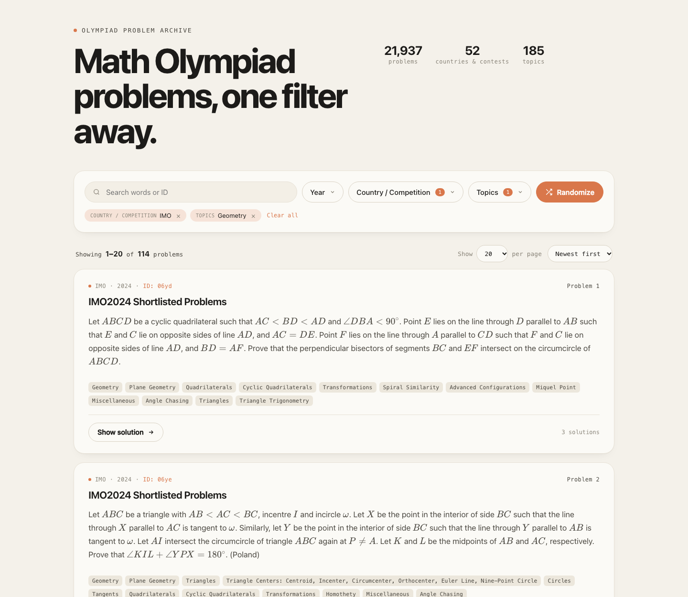
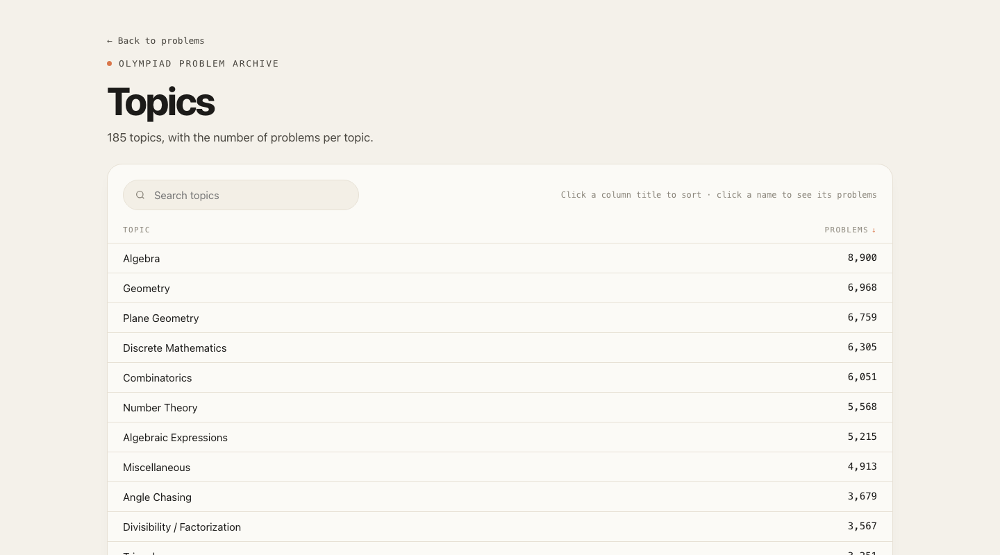

# Olympiad Problem Archive

**Math Olympiad problems, one filter away.**

A fast, self-contained website for browsing **21,937 English-language math olympiad problems**, with
official solutions and figures, from national and international competitions. You can filter them by
year, country or competition, and topic.



---

## What this project is

Olympiad problems are spread across hundreds of competition booklets from dozens of countries. The
[MathNet](https://mathnet.mit.edu) dataset (MIT, ICLR 2026) collects about 28,000 of them, with expert
solutions, in a machine-readable form, but you can't easily *read and browse* it.

This project turns that dataset into a website where anyone can:

- **find problems** by year, country/competition and topic (185 topics, from *Algebra* to
  *Manifolds*);
- **read them properly**, with typeset mathematics and the original diagrams;
- **reveal the official solution** only when they want it;
- **jump to a random problem** for practice;
- **share a link** to exactly the list they are looking at.

The site is **static and fully self-contained**. It has no database, no server-side code and no external
CDN. Every library and every problem is inside the `site/` folder, so it runs on any web server, on
GitHub Pages, or straight from a double-click on `index.html`.

## Features

**Main page (`index.html`)**
- Search by words in the problem or by problem ID.
- Multi-select dropdowns for **Year**, **Country / Competition** and **Topics**, each with its own search
  box and per-option problem counts. Different dropdowns combine with AND; several choices in one dropdown
  combine with OR.
- **Randomize**, which shuffles the problems that match the current filters.
- Sort by newest, oldest or country, and show 20, 50 or 100 problems per page.
- Problem frames showing the country, year, unique ID, competition name, statement with figures, and
  clickable topic tags.
- A **Show solution** button that reveals one or more official solutions inside the frame.
- The current filters, search, sort and page are stored in the URL, so views can be bookmarked or shared.

**Countries & Contests (`countries.html`)** and **Topics (`topics.html`)**
- Sortable tables listing the number of problems per country/contest and per topic.
- Starts-with search, and links that open the main page already filtered.



**Everywhere**
- Automatic light and dark mode, and layouts that work on phones.
- No tracking, no external requests.

## Quick Start

**View it:** open `site/index.html` in any modern browser. Nothing needs to be installed.

**Serve it locally:**

```bash
cd site
python3 -m http.server 8000      # then open http://localhost:8000
```

**Publish it:** copy the contents of `site/` to any web server (Apache, Nginx, XAMPP, LAMP, Tomcat…).

**GitHub Pages:** Pages can only publish from the repository root or a `/docs` folder, not from `site/`.
Either move the contents of `site/` to the root of a `gh-pages` branch, or deploy the `site/` folder
with a GitHub Actions Pages workflow.

Full setup, rebuild and troubleshooting steps are in **[instructions.md](instructions.md)**.

## Repository Layout

```
├── README.md              ← this file
├── instructions.md        ← installation, launch, page-by-page guide, troubleshooting
├── site/                  ← the website (publish this folder)
│   ├── index.html, countries.html, topics.html
│   ├── app.js, list.js, style.css
│   ├── data/              ← generated: filter index, search index, one file per problem
│   ├── img/               ← generated: 5,486 figures
│   ├── vendor/            ← bundled KaTeX 0.16.11 and marked 12.0.2
│   └── SUMMARY.md         ← how the site was designed and built
├── build/                 ← Python scripts that generate site/data and site/img
│   ├── build_site.py      ← dataset → site data
│   ├── make_ignored.py    ← finds non-English problems → ignored.csv
│   ├── topics.py          ← topic splitting, title-casing, merging misspelled names
│   └── requirements.txt   ← pyarrow, langdetect
├── data/MathNet/          ← source dataset (parquet) + ignored.csv + langcheck.py
└── docs/                  ← README screenshots
```

## How it Works

1. **`build/make_ignored.py`** runs MathNet's own language check on every problem and writes the
   non-English ones (5,880) to `data/MathNet/ignored.csv`, keyed by problem ID. The file can be edited by
   hand to hide or restore individual problems.
2. **`build/build_site.py`** reads the dataset, skips the ignored IDs, and generates:
   - `site/data/index.js`, a compact filter index (0.75 MB) loaded when the page opens;
   - `site/data/search.js`, the search text (6.5 MB), loaded only on the first search;
   - `site/data/p/<xx>/<id>.js`, one small file per problem, loaded only when it appears on screen;
   - `site/img/`, the figures, pulled out of the parquet files.

   Along the way it reads each problem's year from its competition name, splits topic paths so a problem
   belongs to every level, and title-cases and de-duplicates the topic names.
3. The browser does all filtering, sorting and paging. Data files are JavaScript rather than JSON, so the
   site works even when opened from disk (`file://`).

To rebuild after changing `ignored.csv` or the topic corrections:

```bash
python3 -m venv .venv
.venv/bin/pip install -r build/requirements.txt
.venv/bin/python build/build_site.py        # about 15 seconds
```

## Statistics

| | |
|---|---|
| Problems published | **21,937** (English) of 27,817 in MathNet v0 |
| Figures | 5,486 |
| Countries & contests | 52 |
| Topics | 185 |
| Years | 1989–2025, plus *Year Unknown* for competitions without a year in their name |
| Site size | ~339 MB (about 27,500 files) |

## Known Limitations

- **Most problems have no year.** About 78% of problems carry no year in their competition name, so they
  are grouped under *Year Unknown*.
- **2,804 problems have no solution** in the source dataset.
- **Topic labels may contain errors.** MathNet's topic labels and some extraction details were produced
  with LLM assistance, so a few may be imperfect.
- **Bilingual problems are kept.** Problems printed in another language together with an English
  translation stay on the site.

## Credits & License

- **Problems and solutions:** [MathNet v0](https://huggingface.co/datasets/ShadenA/MathNet), MIT, licensed
  [CC BY 4.0](https://creativecommons.org/licenses/by/4.0/). Paper: *MathNet* (ICLR 2026),
  [arXiv:2604.18584](https://arxiv.org/abs/2604.18584). Please keep this attribution when you redistribute
  the site or its data.
- **Bundled libraries:** [KaTeX](https://katex.org) and [marked](https://marked.js.org), both MIT-licensed.
